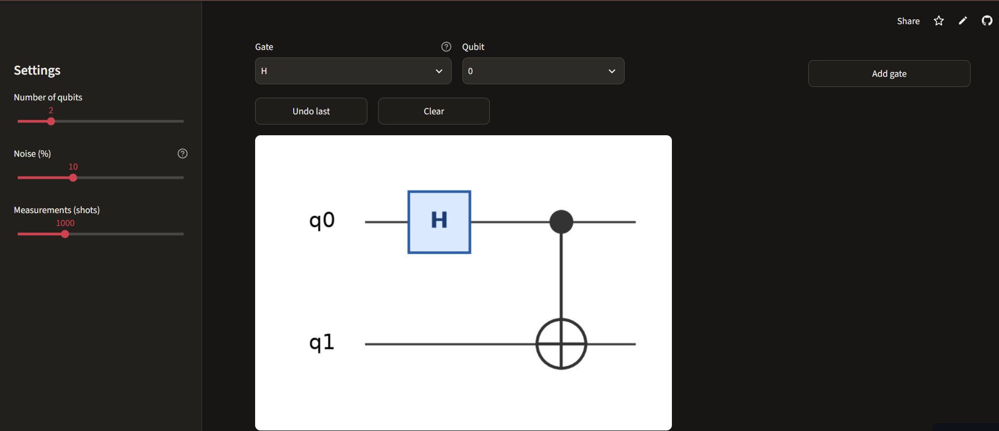
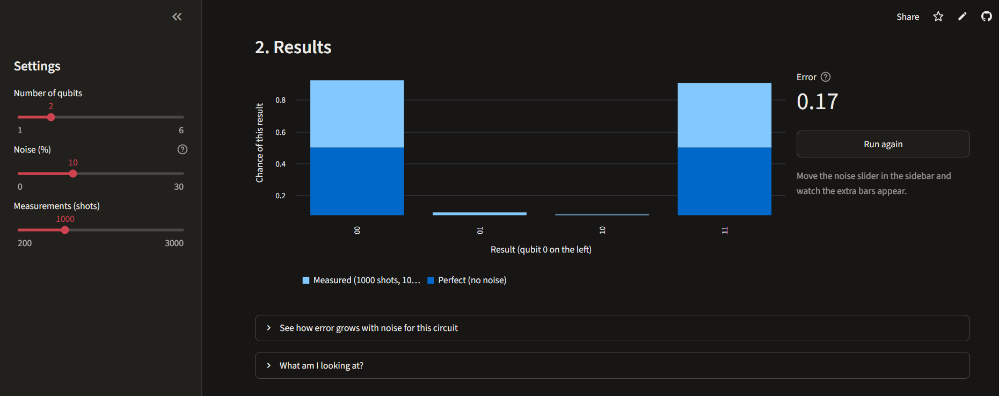
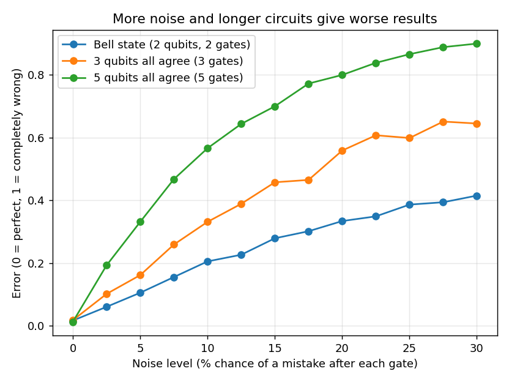

# Quantum Circuit Simulator

A small quantum circuit simulator written from scratch in Python (NumPy), with a noise model and a Streamlit web interface. I built it to understand how quantum circuits actually work, so it does not use Qiskit or any other quantum library.

You place gates on qubits, press run, and see the chance of each result as a bar chart. A noise slider makes gates randomly go wrong, so you can see how mistakes affect the results.

## Run it

```bash
python -m venv .venv
source .venv/bin/activate        # Windows: .venv\Scripts\activate
pip install -r requirements.txt
streamlit run app.py
```

Run the tests with `pytest`.

## Quantum Circuit Simulator Streamlit App Link
- https://quantum-circuit-simulator-2621.streamlit.app/




## How it works

- A **qubit state** is a list of numbers. For `n` qubits the list has `2^n` numbers, one per possible result (`00`, `01`, `10`, `11`, ...).
- A **gate** is a matrix. Applying a gate is a matrix-vector multiplication.
- Gates supported: `H`, `X`, `Z` and `CNOT` (on any pair of qubits).
- **Measuring** picks one result at random, using each number squared as its chance.
- **Noise:** after each gate, every qubit the gate touched has a small chance of being flipped by mistake. With noise on, each measurement is its own run with its own random mistakes.
- **Error** is a single number from 0 to 1 showing how far the noisy results are from the perfect ones.

## Project files

| File | What it does |
|---|---|
| `quantum.py` | The simulator: gates, `Circuit` class, measurement, noise |
| `app.py` | Streamlit web interface |
| `diagram.py` | Draws the circuit picture |
| `noise_demo.py` | Makes the error-vs-noise graph below |
| `test_quantum.py`, `test_app.py` | Tests, including known circuits like the Bell state |

## Testing

The tests check known results: `X` flips a qubit, `H` twice returns to the start, `H-Z-H` acts like `X`, and the Bell state (`H` then `CNOT`) gives only `00` and `11`, each about half the time. They also check that noise creates wrong results and that more noise gives more error.

## What I found



In my runs, more noise gave worse results, and longer circuits suffered more because every extra gate is another chance for a mistake. At 10% noise, the 5-qubit circuit was clearly worse than the 2-qubit Bell state.

## Limitations

- It stores every number for every qubit, so it is limited to a few qubits (6 in the app, 10 in the code).
- The noise model is simple random flips. Real quantum hardware noise is more complicated.
- It has only four gates and no rotations or other gates.
- It is a learning project, not a replacement for tools like Qiskit.

## Ideas for later

- Add more gates (S, T, rotation gates).
- Check results against Qiskit on the same circuits.
- Add other noise types.
